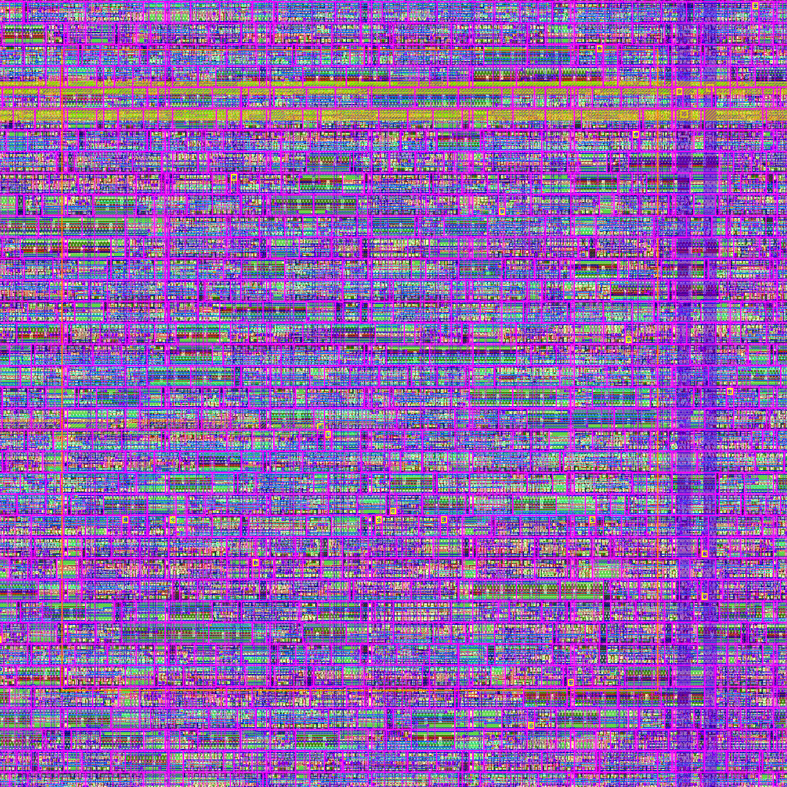

# RV32I Single-Cycle Core: RTL to GDSII on Sky130

A single-cycle RV32I processor taken from SystemVerilog RTL to a DRC/LVS-clean GDSII layout using the open-source OpenLane 2 (OpenROAD) flow on the SkyWater Sky130A PDK.



## Results

Run 3 is the final result. It uses `src_x0`, the RTL with register x0 hardwired to zero, which is the version verified in simulation. Run 2 is kept for comparison.

| Item | Run 3 (final, 36 ns, `src_x0`) | Run 2 (32 ns, `src`) |
|---|---|---|
| Technology | Sky130A, OpenLane 2.3.10 | same |
| Clock target | 36 ns (27.8 MHz) | 32 ns (31.25 MHz) |
| DRC (Routing / Magic / KLayout) | 0 / 0 / 0 | 0 / 0 / 0 |
| LVS | Clean, 0 unmatched nets/devices | Clean |
| Setup, typical corner (tt) | +6.44 to +7.12 ns, met | +5.58 to +6.13 ns, met |
| Setup, fast corner (ff) | +8.34 to +8.52 ns, met | +7.88 to +8.04 ns, met |
| Setup, slow corner (ss) | -2.75 to -4.00 ns, NOT met | -2.59 to -3.79 ns, NOT met |
| Hold, all 9 corners | Met (min +0.11 ns) | Met (min +0.11 ns) |
| Fmax estimate (tt, lower bound) | about 33.8 MHz | about 37.9 MHz |
| Die area | 568 x 579 um (0.329 mm2) | 581 x 592 um (0.344 mm2) |
| Standard-cell area | 159,759 um2, 51.7% utilization | 174,924 um2, 54% utilization |
| Cells / flops | 19,707 / 2,528 | 21,234 / 2,610 |
| Power (tt, nominal) | 28.8 mW (default switching activity) | 32.5 mW |

Fmax is estimated as 1 / (clock period - worst setup slack). It is a lower bound because the flow does not push timing when the target is relaxed. An earlier 20 ns run on `src` came within 0.02 ns of meeting setup at the typical corner (about 50 MHz), but failed the slow corner.

## Status and known limitations

Stated plainly, so nothing here is oversold:

- **Setup timing is met at the typical and fast corners, and NOT at the slow corner (ss).** Relaxing the clock from 32 ns to 36 ns did not fix it. The slow-corner slack got worse (-3.79 ns to -4.00 ns), because the resizer stops optimizing once the target is easy and only repairs the typical corner. Closing ss would need a repair step that targets the slow corner, or a much longer period.
- OpenLane enforces its checkers at the typical corner by default, so the flow reports "complete" even with ss violations. The ss failures are listed here on purpose.
- 34 antenna violations remain after routing. 147 max-slew violations (ss only) and 152 max-fanout violations are reported and not repaired.
- Power uses default switching activity, not this program's real activity.
- Memories are small and flop-based: 23-word hardcoded program ROM, 64 x 32 data memory, 32 x 32 register file. This is why area and power are large for a simple core.
- Verification covers one directed test program (sum of 25+12+48+7+31 = 123 stored in x7). It is not full RV32I compliance testing.
- No power-grid IR-drop sign-off was performed.

## What is in this repo

```
rtl_orig/      Original SystemVerilog from the Vivado project (untouched)
src/           Synthesizable version used for run 2
src_x0/        Same as src with register x0 hardwired to zero (run 3, final)
config.json    OpenLane configuration (run 2)
config_run3.json   OpenLane configuration (run 3)
report_routed.tcl   OpenROAD Tcl script: loads routed SPEF, reports setup, hold and power
reports/       Final timing, power and DRC/LVS reports
verify/        Icarus testbench, comparison scripts, saved results, README
images/        Layout images
```

## Flow

1. Make the RTL synthesizable (see changes below).
2. Run the full OpenLane 2 flow in Docker: synthesis, floorplan, placement, CTS, global and detailed routing, parasitic extraction, STA at nine corners, Magic and KLayout DRC, Netgen LVS.
3. Verify the hardened RTL against the original by simulation (PC trace, all 32 registers, all data memory).
4. Run `report_routed.tcl` in OpenROAD on the routed result. Its typical-corner setup, hold and power match the flow's own numbers in both runs.

## RTL changes made for synthesis

- `InstructionMemory`: initial-block array replaced by a combinational ROM (64 words, 23 hardcoded program words).
- `data_memory`: index uses `alu_out[5:0]`, output defaults to 0 when not reading (removed an inferred latch).
- `register_file`: reset and write merged into one `always @(negedge clk)` block (previously two blocks drove the same array). In `src_x0`, writes to x0 are ignored and reads return 0.
- `control_unit`: `always_comb` with defaults, `1'b?` don't-cares set to 0.
- `imm_gen`: explicit sign replication instead of `$signed(inst[31])`.
- `Wrapper`: nets declared before use, duplicate `mem_write` declaration removed, `pc_out` output added so synthesis keeps the design.
- `alu_control_real` kept as `alu_control`. The older if-chain version was dropped because it inferred latches and lacked SLL.

## Bug found during verification

The original `control_unit` used `always @(inst)` while reading `opcode` from a separate continuous assignment. In simulation the block ran before `opcode` updated, so each instruction was decoded with the previous instruction's opcode and the program diverged at the loop branch (pc=80). Changing the sensitivity list to `always @*` made the original match the hardened RTL exactly. Synthesis builds combinational logic, so the layout reflects the correct behavior.

## Reproduce

```
# Flow (Docker required)
openlane --dockerized --pdk sky130A config_run3.json

# Verification
verify/run_sim.sh
```

## Tools

OpenLane 2.3.10, OpenROAD, Yosys, Magic, Netgen, KLayout, Icarus Verilog, Sky130A PDK (volare), WSL2 Ubuntu.
